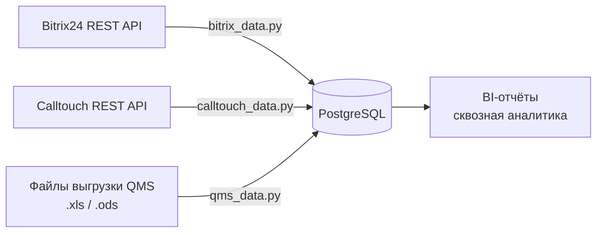

# Medclinic Data Transfer

ETL-пайплайн для сквозной аналитики медицинского центра: ежедневно собирает данные о лидах, звонках и записях пациентов из трёх независимых систем и загружает их в единую базу PostgreSQL.


## Задача

Данные о пациенте до приёма разбросаны по разным системам:

| Система | Что хранит | Как отдаёт данные |
|---|---|---|
| **Bitrix24** (CRM) | Лиды, этапы воронки, UTM-метки, источники заявок | REST API |
| **Calltouch** (коллтрекинг) | Звонки из рекламных источников | REST API |
| **QMS** (медицинская информационная система) | Звонки в колл-центр и их результаты | Ежедневная выгрузка файлов `.xls` / `.ods` |

Без общей базы невозможно ответить на главный вопрос маркетинга: **какой источник приводит пациентов, которые действительно записываются на приём**. Проект сводит все три источника в PostgreSQL, где их можно связать по нормализованному номеру телефона и строить отчёты в BI.

## Архитектура



Каждый источник обрабатывается отдельным скриптом, который запускается по расписанию (cron). Общая логика вынесена в модули:

```
├── bitrix_data.py      # Лиды Bitrix24 + справочники источников
├── calltouch_data.py   # Журнал звонков Calltouch
├── qms_data.py         # Разбор файловых выгрузок QMS
├── psgsql_connect.py   # Подключение к PostgreSQL, пакетная вставка
├── utils.py            # HTTP-сессия с ретраями, нормализация телефонов, разбор периода
└── logger.py           # Общий файловый лог по дням
```

## Технические решения

**Надёжная работа с API**
- Пагинация: выгружаются все страницы ответа, а не только первая (`start/next` в Bitrix24, `page/pageTotal` в Calltouch).
- HTTP-сессия с автоматическими повторами и экспоненциальной задержкой при сетевых ошибках и ответах `429` / `5xx`, а также таймауты на каждый запрос.
- Ответы с ошибкой не проходят молча: код и тело ответа попадают в лог.

**Идемпотентная загрузка**
- Bitrix24 и Calltouch загружаются через `INSERT ... ON CONFLICT DO UPDATE`: повторный запуск за тот же период обновляет записи, а не создаёт дубли.
- Перед вставкой дубликаты ключа удаляются внутри пакета, потому что PostgreSQL не позволяет обновить одну строку дважды в одном `ON CONFLICT`.
- Пакетная вставка через `execute_values` (по 1000 строк) вместо построчных запросов.

**Разбор файлов QMS**
- Поддерживаются два формата выгрузки: HTML-таблица в `.xls` и `.ods`.
- QMS формирует `.ods`-архивы без обязательного файла `mimetype`, поэтому стандартные библиотеки (pandas/odfpy) их не открывают. Написан собственный парсер `content.xml` с учётом объединённых и «повторённых» ячеек.
- Выгрузки пересекаются по датам, поэтому за каждый день берутся данные только из самого свежего файла.
- Замена данных за день (`DELETE` + `INSERT`) выполняется в одной транзакции: при ошибке старые данные не теряются.
- Обработанные файлы запоминаются, повторно они не загружаются. Повреждённый файл пропускается и не останавливает обработку остальных.

**Качество данных**
- Номера телефонов из всех систем приводятся к единому формату `7XXXXXXXXXX`. Это ключ для связи лида, звонка и записи к врачу.
- Названия источников из справочников Bitrix24 подставляются к лидам вместо внутренних ID.

**Эксплуатация**
- Все параметры подключения и секреты хранятся в `.env`, в коде их нет.
- Общий лог по дням: количество полученных и записанных строк, полный traceback при критической ошибке.
- При ошибке скрипт завершается с ненулевым кодом, чтобы планировщик или мониторинг могли её заметить.

## Запуск

```bash
python -m venv .venv
source .venv/bin/activate        # Windows: .venv\Scripts\activate
pip install -r requirements.txt
```

Создайте файл `.env` в корне проекта:

```ini
# PostgreSQL
db_host=localhost
db_user=
db_password=

# Bitrix24 (входящий вебхук)
bitrix_host=        # поддомен портала: <bitrix_host>.bitrix24.ru
bitrix_user=
bitrix_token=

# Calltouch
ct_site_id=
ct_api_token=

# Пути
qms_dir=/path/to/qms_files
log_dir=/path/to/log
```

По умолчанию скрипты API выгружают данные за вчерашний день. Период можно задать явно, например для дозагрузки истории:

```bash
python bitrix_data.py
python calltouch_data.py --date-from 2026-09-01 --date-to 2026-09-30
python qms_data.py               # обрабатывает все новые файлы в qms_dir
```

Пример расписания cron:

```cron
0 6 * * *  cd /opt/medclinic_data_transfer && .venv/bin/python bitrix_data.py
5 6 * * *  cd /opt/medclinic_data_transfer && .venv/bin/python calltouch_data.py
10 0 * * * cd /opt/medclinic_data_transfer && .venv/bin/python qms_data.py
```

## Стек

Python · pandas · PostgreSQL (psycopg2) · requests / urllib3 Retry · REST API (Bitrix24, Calltouch) · ODS/XML-парсинг · python-dotenv
